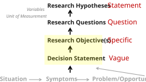
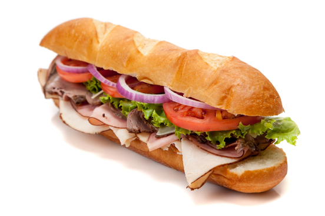
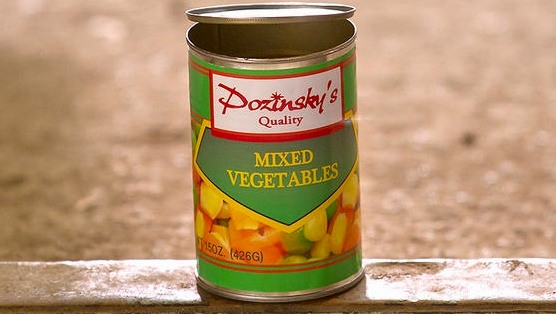
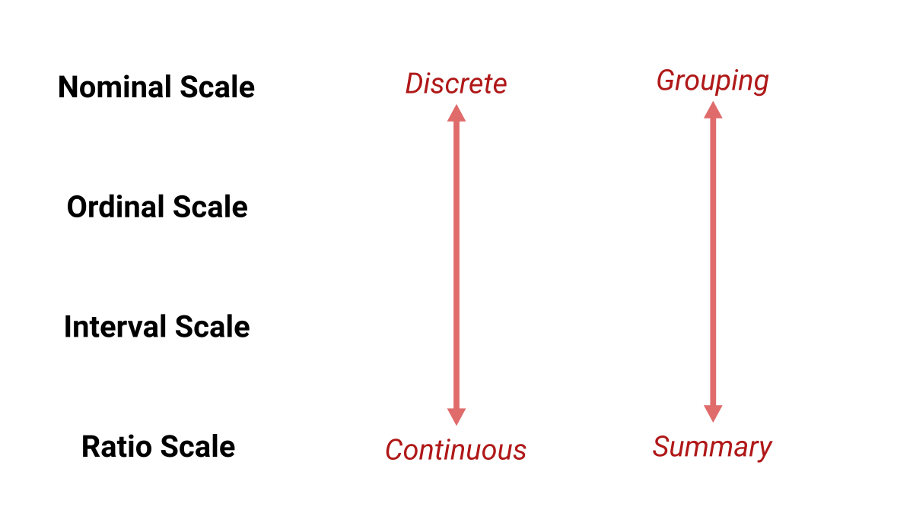

## [Computers and Questions]{.sr-only} {background-color="#000000" .w12-definition-quote-slide}

::: w12-definition-quote
> "Computers are useless, they can only give you answers."

Pablo Picasso
:::

::: notes
Opening quotation retained from the original Week 12.1 deck, including its
attribution. Ask what a computer needs from us before it can produce a useful
answer. The focus today is the decision and the definitions behind the data.
:::

## Decision Making {.w12-definition-decision}

::: w12-definition-decision-text
Developing and deciding among alternative ways of resolving a problem or
choosing from among alternative opportunities.
:::

### Research's role

- Recognize the nature of the problem or opportunity.
- Identify how much information is available and how reliable it is.
- Determine what information is needed to make the decision.

## Research Design

{width="100%" height="580px" fig-alt="The course research-design diagram with the decision statement and research objectives highlighted in yellow."}

::: notes
Reuse the Week 5 diagram. Distinguish the decision statement from the research
objectives. One asks what action to take. The other states what we need to
learn to inform that action.
:::

## Campus Dining - Decision Maker

::: w12-definition-dining
::: w12-definition-dining-list
- Students
- Dining Services
- Administration
- Local Restaurant
:::

{fig-alt="A sandwich, as shown in the original campus dining decision-maker slide."}
:::

::: notes
Develop the decision statements and research objectives in class for each
decision maker. Leave students to propose the questions.
:::

## Relationships

 

:::::: columns
::: {.column width="40%"}
### Independent Variable

 

On/Off Campus\
GPA\
Exercise\
BMI

 

*Keep track of (control)*\
*Input*
:::

::: {.column width="20%"}
*affects*
:::

::: {.column width="40%"}
### Dependent Variable

 

GPA\
On/Off Campus\
BMI\
Exercise

 

*Measure outcome*\
*Prediction*
:::
::::::

::: {.callout-important .fragment title="Hypothesis"}
An educated guess about how the **independent variable** affects the **dependent variable**.
:::

::: notes
This is the same variable pairing and layout used in Week 5. Use it as a brief
connection to prior work. Ask which variable is the input and which is the
outcome for each proposed relationship. A stated direction does not by itself
establish causation.
:::

## Determine Who Utilizes Campus Dining Services - Concepts

::: w12-definition-dining
::: w12-definition-dining-list
- Age
- Gender
- Time of day
- Food preference
:::

{fig-alt="An open can of mixed vegetables, as shown in the original campus dining concepts slide."}
:::

::: notes
These are the concepts listed in the original deck. Ask students what they
would need to agree on before writing a survey question about each one.
:::

## Defining the Concept

::: w12-definition-terms
Concept
: What is the general idea?

Conceptual Definition
: How does your group define it?

Operational Definition
: How will you measure it? What question will you give your respondent?

Measurement Scale
: What options does the respondent have to give you data? What are the response categories?

Data Type
: What does the raw data look like? How can you use it?
:::

::: notes
Preserve the five distinctions in the original slide. Walk through time of
day as a class. For example, define evening as after 5 p.m., then ask when the
respondent most recently used campus dining. Discuss how recording a clock
time differs from offering ordered time-period categories.
:::

## Measurement Scales

{width="100%" height="580px" fig-alt="The course measurement-scale diagram shows nominal, ordinal, interval, and ratio scales, their relationship to discrete and continuous data, and their use for grouping and summaries."}

::: notes
Reuse the measurement-scale image from Week 2. Return to one campus dining
concept and ask the class to propose a definition, a survey question, and
response options. Identify the measurement scale and what a row of the
resulting dataset would contain.
:::
