# Can our sample represent the population?

## Class Survey

 

[Take the class survey](https://survey.60land.com/index.php/931648).

We will use the responses to compare sampling methods. As you answer, notice
how the questions and response options are written.

# Population to Sample



## From Population to Survey Results

 

| Stage             | Question                      |
|-------------------|-------------------------------|
| Target population | Who do we want to understand? |
| Sampling frame    | Who could be selected?        |
| Planned sample    | Who did we try to select?     |
| Respondents       | Who actually answered?        |
| Final estimate    | What did we conclude?         |

::: notes
Ask where people could be left out between the population and the responses we receive.
:::

# Random vs Representative

## Random and Representative

<table class="w12-sampling-matrix">
<thead><tr><td></td><th scope="col">Representative</th><th scope="col">Not representative</th></tr></thead>
<tbody>
<tr><th scope="row">Random</th><td>The goal</td><td>Can happen, even with random selection</td></tr>
<tr><th scope="row">Not random</th><td>Possible, but selection still matters</td><td>A concern with convenience samples</td></tr>
</tbody>
</table>

# Sampling Methods

## How will we choose the sample?

 

Who can be selected, and how will we select them?

The selection rule determines the sampling method.

## [Probability Sampling]{.sr-only} {.w12-method-slide background-image="media/images/w12_go.jpeg" background-size="cover"}

<h3>Probability Sampling</h3>

Each unit has a known, nonzero chance of selection.

## [Nonprobability Sampling]{.sr-only} {.w12-method-slide background-image="media/images/w12_spider.jpeg" background-size="cover"}

<h3>Nonprobability Sampling</h3>

Selection depends on access, judgment, or volunteers.

## [Simple Random Sample]{.sr-only} {.w12-method-slide}

<a class="w12-coin-callback" href="https://shiny.60land.com/week06/coinflipper/">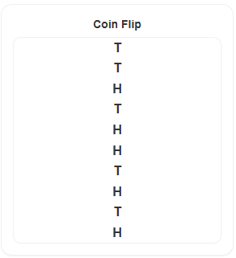</a>
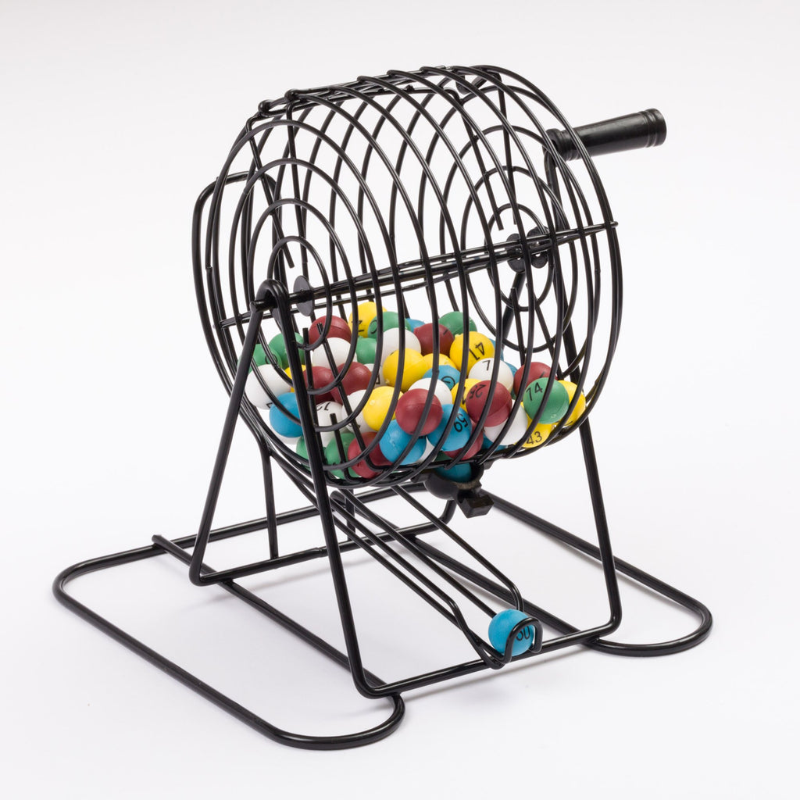

<h3>Simple Random Sample</h3>

Every unit has an equal chance of selection.

::: notes
A simple random sample gives every possible sample of a given size the same
chance of selection. Use the bingo cage to illustrate drawing without choosing
particular numbers. The coin-flip image on the left links to the Week 6 example:
random selection can still produce a run or an uneven short sample.
:::

## Systematic Sample

  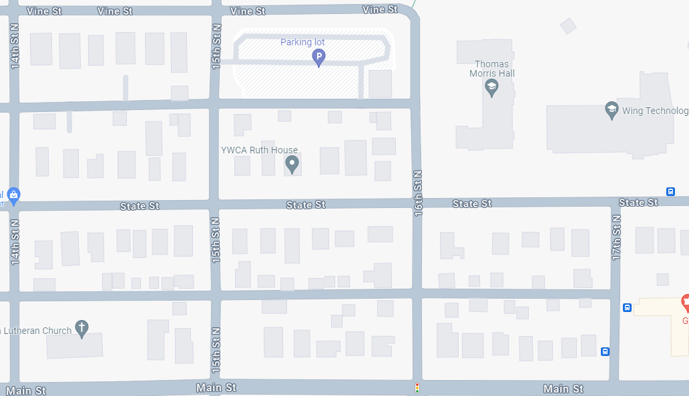
  
+

  
&times;

  
&times;

  
&times;

  
&times;

  
&times;

  
+

  
&times;

  
&times;

  
&times;

  
&times;

  
&times;

  
+

  
&times;

  
&times;

  
&times;

  
&times;

  
&times;

  
+

  
&times;

  
&times;

  
&times;

  
&times;

  
&times;

  
+

  
&times;

  
&times;

  
&times;

  
&times;

  
&times;

  
+

  
&times;

  
&times;

  
&times;

  
&times;

  
&times;

  
+

  
&times;

  
&times;

  
&times;

  
&times;

  
&times;

  
+

  
&times;

  
&times;

  
&times;

  
&times;

  
&times;

  
+

  
&times;

  
&times;

  
&times;

  
&times;

  
&times;

  
+

  
Start at the first address, then select every sixth address.

## [Convenience Sample]{.sr-only} {.w12-method-slide background-image="media/images/w12_marathon.jpeg" background-size="cover"}

<h3>Convenience Sample</h3>

Select people who are easy to reach.

## [Stratified Sample]{.sr-only} {.w12-method-slide background-image="media/images/w12_red_white.jpeg" background-size="cover"}

<h3>Stratified Sample</h3>

Divide the population into groups, then randomly sample within each group.

## [Quota Sample]{.sr-only} {.w12-method-slide background-image="media/images/w12_black_yellow.jpeg" background-size="cover"}

<h3>Quota Sample</h3>

Fill a target number from each group without random selection.

## [Cluster, Judgment, and Snowball Samples]{.sr-only} {.w12-method-slide background-image="media/images/w12_larp.jpeg" background-size="cover"}

<strong>Cluster:</strong> randomly select groups, then include their members.

<strong>Judgment:</strong> select people for their relevant knowledge.

<strong>Snowball:</strong> ask participants to refer other participants.

## Multistage Area Sample

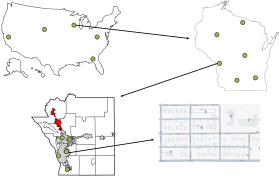{width=100%}

# Sampling Lab

## Compare Samples

1. Choose an outcome and sample size in the [sampling app](https://shiny.60land.com/week12/samplinglab/).
2. Compare a random sample with a convenience sample.
3. Draw another sample. What changes?

Compare both the outcome and who is included with the full response pool.
Record your comparisons in Guided Notes 6.

::: notes
Keep the outcome and sample size fixed when comparing methods. Compare class
standing or attendance as well as the outcome. The response pool is our
reference for this exercise; it may not represent the whole university.
:::

## Bias Sources

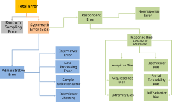{width=100%}

# Survey Design

## Questions from Our Survey

 

Which questions were easy to answer? Which made you pause?

Look at the wording, the choices, and whether you could give the answer you wanted.

## Select One

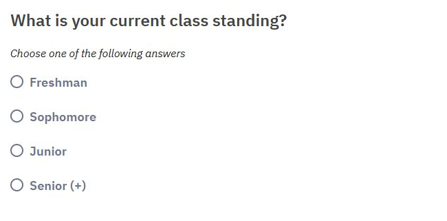{height=390px fig-alt="Class survey: class standing with four radio-button choices"}

Can everyone choose one answer that fits?

## Select All That Apply

{height=460px fig-alt="Class survey: majors with checkboxes for multiple selections"}

Would the percentages add to 100%?

## Ordered Response Scale

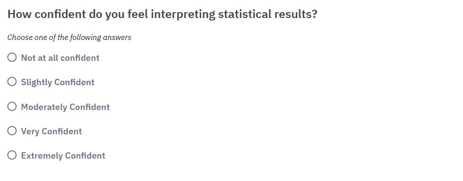{height=440px fig-alt="Class survey: confidence interpreting statistical results, from not at all to extremely confident"}

## Likert Scale

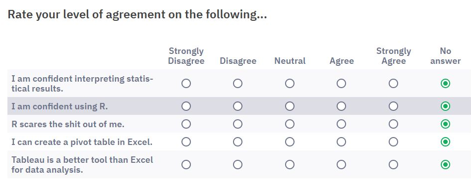{width=950px fig-alt="Class survey: agreement statements with strongly disagree through strongly agree choices"}

::: notes
Compare this agreement scale with the confidence question on the preceding
slide. Discuss what each response tells us and how the statements are worded.
:::

## Semantic Differential

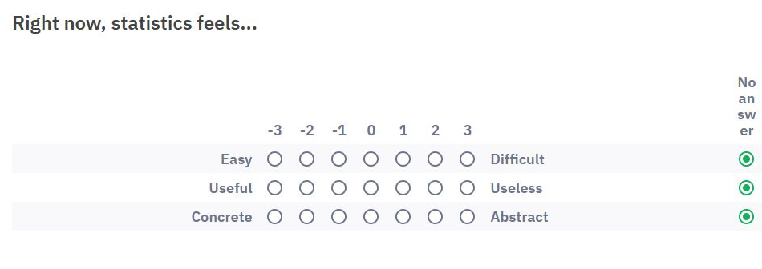{width=950px fig-alt="Class survey: statistics rated between easy and difficult, useful and useless, concrete and abstract"}

What do the two ends of each scale mean?

## Numeric Scales Need Anchors

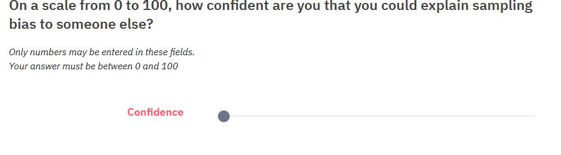{width=950px fig-alt="Class survey: a zero-to-100 slider for confidence explaining sampling bias"}

What does 0 mean? What does 100 mean?

::: notes
Discuss whether numerical bounds alone explain the scale. Compare with explicit
anchors: 0 = not confident at all; 50 = somewhat confident; 100 = completely
confident. These are discussion examples, not labels shown in the live question.
:::

## Constant Sum

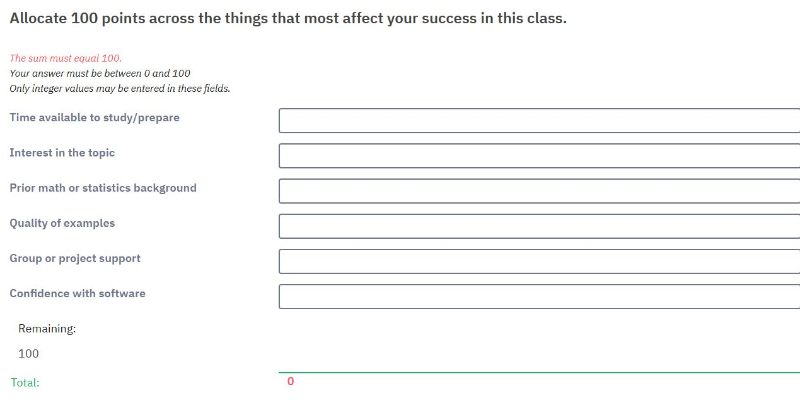{height=530px fig-alt="Class survey: allocate 100 points among six influences on success in class"}

::: notes
The total must equal 100. Ask what allocating more points to one item requires
students to do with the others.
:::

## Graphic Rating Scales

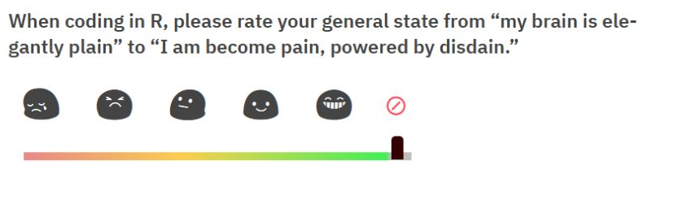{.w12-survey-faces fig-alt="Class survey: five faces from sad to happy for rating how coding in R feels"}

::: notes
Use the face scale students saw in the survey as the graphical rating example.
Discuss how the scale is presented and what the endpoints mean.
:::

## Drilldown Questions

 

::: {.callout-note title="Drilldown"}
Start broad, then narrow the choices.
:::

 

Better than forcing people through a giant pick list.

Example:

College -\> Department -\> Major

## Answer Categories in Our Survey

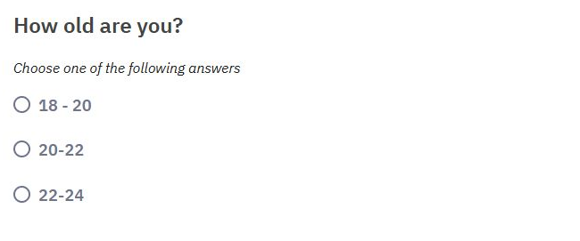{height=360px fig-alt="Class survey: age categories 18 to 20, 20 to 22, and 22 to 24"}

Where would a 20-year-old fit? What about someone who is 25?

## Collectively Exhaustive vs Mutually Exclusive

:::: {.q-example}
::: {.q-title}
Question categories can fail in different ways
:::

::: {.q-col .left}
::: {.col-head}
Collectively Exhaustive
:::

::: {.prompt}
How old are you?
:::

- 18-20
- 20-22
- 22-24

::: {.prompt}
How old are you?
:::

- < 18
- 18-20
- 20-22
- 22-24
- 24+
:::

::: {.q-col .right}
::: {.col-head}
Mutually Exclusive
:::

::: {.prompt}
How old are you?
:::

- 18-20
- 21-22
- 23-24

::: {.prompt}
How old are you?
:::

- < 18
- 18-20
- 21-22
- 23-24
- 25+
:::

::: {.frame}
{.food fig-alt="Birthday cake"}
:::
::::

## [Generate Variance]{.sr-only} {.w12-question-example}

:::: {.q-example}
::: {.q-title}
Generate Variance
:::

::: {.q-col .left}
:::{style="width: 46%;"}
::: {.prompt}
How many meals per day do you eat?
:::

- 0-5
- 6-10
- 11+

::: {.prompt}
How many meals per day do you eat?
:::

- Less than 1
- 1
- 2
- 3
- More than 3
:::
:::

{.food fig-alt="Potatoes"}
::::

## [Sensitivity]{.sr-only} {.w12-question-example}

:::: {.q-example}
::: {.q-title}
Sensitivity
:::

::: {.q-col .left}
::: {.prompt}
I am bored.
:::

- Strongly Disagree
- Disagree
- Neutral
- Agree
- Strongly Agree

::: {.prompt}
I am bored.
:::

- Disagree
- Agree

::: {.prompt}
I am bored.
:::

- Strongly Disagree
- Disagree
- Somewhat Disagree
- Agree
:::

::: {.q-col .right}
:::{style="font-size: 0.72rem;"}
::: {.prompt}
I am bored.
:::

- Extremely Very Strongly Disagree
- Very Strongly Disagree
- Strongly Disagree
- Disagree
- Extremely Very Moderately Disagree
- Very Moderately Disagree
- Moderately Disagree
- Extremely Very Somewhat Disagree
- Very Somewhat Disagree
- Somewhat Disagree
- Disagree Somewhat
- Kind of Disagree to some extent
- Not Really Disagree
- Neutral
- Moderately Neutral
- Extremely Neutral
- Neutrally Neutral
:::
:::

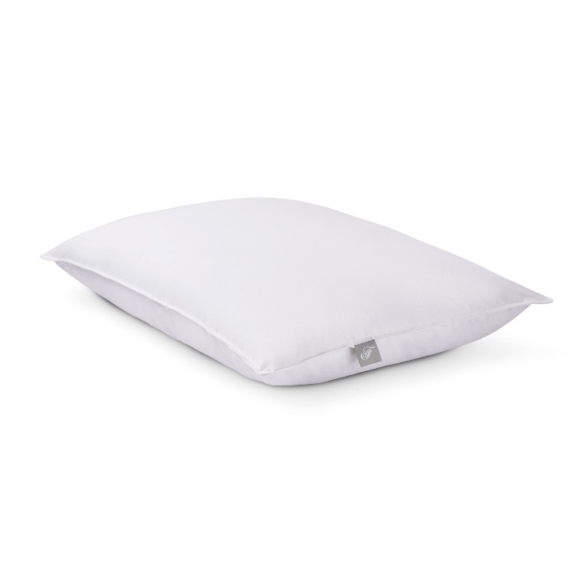{.pillow fig-alt="Pillow"}
::::

## Heat Maps

{.w12-heatmap-image fig-alt="Escher's Print Gallery, the image used in the class survey's click question"}

::: notes
Return to the image-click question in the class survey. Where did students
click? Use the sampling app's image heatmap to compare the class responses.
:::

## Text Boxes

 

::: {.callout-tip title="Open text"}
Text boxes reveal categories the researcher did not anticipate.
:::

 

Example:

> What is something unique about you that a normal survey would not know to ask?

## From Text Boxes to Sampling

 

If someone writes:

> My obscure hobby is competitive speedcubing.

 

How would we sample that population?

::: {.callout-important title="Key link"}
Rare or niche populations often require judgment, cluster, or snowball sampling.
:::

# Bad Questions

## Leading Question

 

Bad:

> How much do you agree that this helpful course improves your analytical thinking?

 

Problem:

The wording pushes respondents toward a positive answer.

## Loaded Question

 

Bad:

> How often do you waste time using AI instead of thinking for yourself?

 

Problem:

The wording judges the respondent before they answer.

## Double-Barreled Question

 

Bad:

> The Shiny apps are easy to use and help me learn the material.

 

Problem:

This asks two questions at once.

## Assumption Question

 

Bad:

> How often do you use ChatGPT to complete your homework?

 

Problem:

It assumes the respondent uses ChatGPT.

## Better Question Flow

 

1.  Have you used ChatGPT or another AI assistant for homework?
2.  If yes, how often?
3.  If yes, for which tasks?
4.  What did you check yourself?

::: notes
Use this to connect back to responsible AI expectations from earlier homework.
:::

# Wrap Up

## What makes a survey good?

 

Survey quality depends on:

-   who could be selected
-   who was selected
-   who responded
-   what they were asked
-   whether the question measured what we think it measured

::: {.callout-tip .fragment title="Before trusting a survey result"}
Ask: who was in the frame, how were they sampled, who responded, and how was the question worded?
:::
